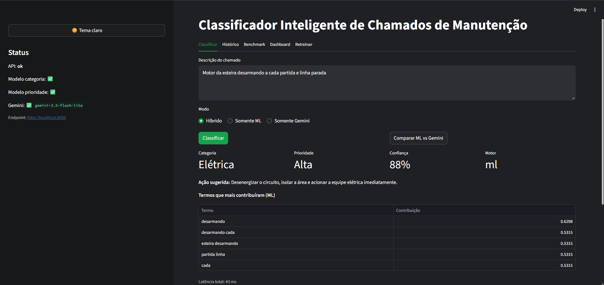
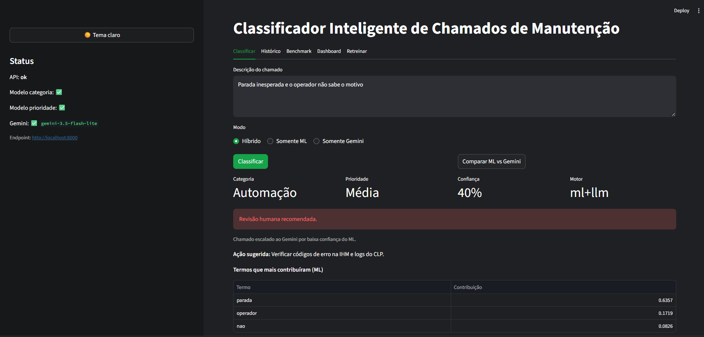
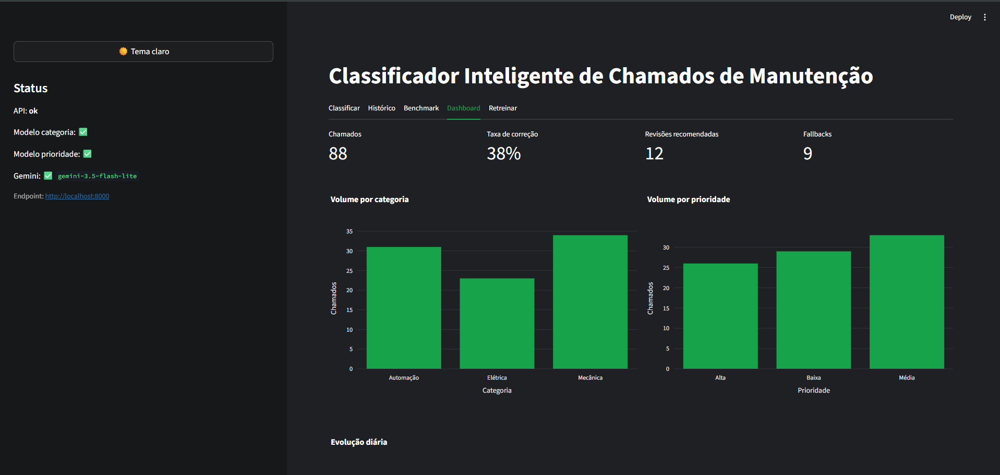
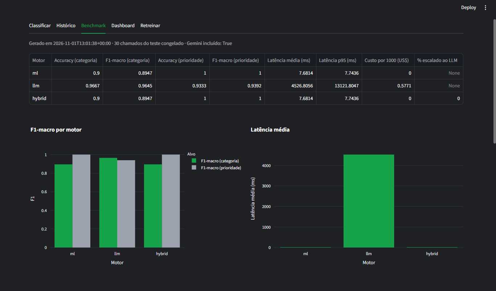

# Classificador Inteligente de Chamados de Manutenção Industrial


API-first com **motor híbrido**: modelo clássico (scikit-learn) + LLM (Gemini). Recebe a descrição de um chamado em português e devolve categoria (Mecânica, Elétrica, Automação), prioridade (Baixa, Média, Alta), confiança, explicação e ação sugerida. Compara, combina e audita os dois motores e aprende com correções humanas.

## Capturas de tela

Tela de classificação no modo Híbrido: com 88% de confiança, o ML respondeu sozinho (motor `ml`), sem chamar o Gemini. Abaixo de 65%, o chamado seria escalado:



Chamado vago ("Parada inesperada e o operador não sabe o motivo"): o ML ficou abaixo do limite de confiança, o chamado foi escalado ao Gemini (motor `ml+llm`) e o sistema recomenda revisão humana:



Dashboard com o volume por categoria e prioridade, a taxa de correção e as revisões recomendadas:



Benchmark de ML, Gemini e híbrido no teste congelado:



## Arquitetura

```
Streamlit (UI) --HTTP--> FastAPI --> [ ML Engine | Gemini Engine | Hybrid Router ] --> SQLite
```

O Streamlit não contém lógica de ML nem chama o Gemini: só consome a API.

```
app/            API, engines (ml, gemini, hybrid), regras de segurança, persistência
ml/             geração do dataset, treino e benchmark
ui/app.py       cliente Streamlit
.streamlit/     tema inicial da interface (config.toml)
tests/          pytest (Gemini sempre mockado)
.github/        integração contínua: roda o pytest a cada push
data/ models/ reports/
iniciar.bat     (Windows) sobe a API e a interface com um clique
parar.bat       (Windows) encerra os dois
```

Fluxo do modo `hybrid`:

1. O ML classifica (rápido e sem custo).
2. Se a confiança fica abaixo de `ML_CONFIDENCE_THRESHOLD` (padrão 0,65), o chamado é escalado ao Gemini.
3. Se ML e Gemini discordam, a resposta marca `revisao_humana` e devolve as duas opiniões.
4. As regras de segurança (fumaça, incêndio, choque, vazamento de gás, emergência etc.) elevam a prioridade para Alta e ativam `regra_aplicada`.
5. Se o Gemini falha, estoura o orçamento de tempo ou a chave não existe, a API segue com o ML e informa `fallback` e `motivo_fallback`.

## Interface

A interface em Streamlit tem cinco abas:

- **Classificar:** escolhe o modo (Híbrido, Somente ML ou Somente Gemini), classifica um chamado e mostra categoria, prioridade, confiança, ação sugerida e os termos que mais contribuíram para o ML. O botão "Comparar ML vs Gemini" mostra os dois motores lado a lado. Abaixo do resultado é possível confirmar a classificação ou corrigi-la, e isso alimenta o retreino.
- **Histórico:** lista os chamados com filtros e exportação em CSV.
- **Benchmark:** exibe o último relatório de `python -m ml.benchmark`: métricas por motor, latência, custo, matrizes de confusão e discordâncias entre ML e Gemini.
- **Dashboard:** total de chamados, taxa de correção, revisões recomendadas, fallbacks, volume por categoria e prioridade, evolução diária e o uso do Gemini (chamadas, tokens, custo estimado, latência mediana e p95).
- **Retreinar:** treina o modelo de ML com as correções e confirmações humanas e mostra as métricas antes e depois no teste congelado.

A interface tem dois temas, alternados por um botão na barra lateral: claro (fundo branco, texto preto, destaque azul) e escuro (fundo cinza escuro, texto branco, destaque verde). Os gráficos acompanham o tema. O tema inicial é o claro, definido em `.streamlit/config.toml`. O botão usa `st._config.set_option`, uma API interna do Streamlit sem garantia de compatibilidade entre versões (por isso o `requirements.txt` fixa `streamlit==1.51.0`), e a troca vale para o servidor inteiro, não por usuário.

## Como obter a chave do Gemini

1. Acesse https://aistudio.google.com/apikey e crie uma chave.
2. Copie `.env.example` para `.env` e preencha `GEMINI_API_KEY` e `GEMINI_MODEL`.
3. A chave só é lida do ambiente e nunca é registrada em logs. Sem chave, o sistema funciona só com ML.
4. **Nunca versione o `.env`.** Ele está no `.gitignore`.

O plano gratuito é suficiente para este projeto, mas os limites variam por modelo (ver "Cotas e escolha do modelo").

## Configuração (`.env`)

Os valores do `.env` têm prioridade sobre os padrões definidos em `app/config.py`. Depois de alterar o `.env`, reinicie a API: o `--reload` observa apenas arquivos `.py`.

| Variável | Padrão no código | Descrição |
|---|---|---|
| `GEMINI_API_KEY` | vazio | Chave da API. Sem ela, só o ML funciona. |
| `GEMINI_MODEL` | vazio | Nome do modelo. O usado nos resultados é `gemini-3.5-flash-lite`. |
| `GEMINI_TIMEOUT_SECONDS` | 45 | Tempo máximo de cada tentativa. |
| `GEMINI_TOTAL_TIMEOUT_SECONDS` | 30 | Orçamento total de tempo por chamado, somando tentativas e esperas. O tempo de cada tentativa é limitado ao que sobrar do orçamento, e não há nova tentativa se a espera não couber nele. |
| `GEMINI_MAX_ATTEMPTS` | 3 | Tentativas por chamado. Cada tentativa conta na cota. |
| `GEMINI_BACKOFF_BASE_SECONDS` | 1 | Espera base entre tentativas (dobra a cada tentativa). Em lotes no plano gratuito, 5 ajuda a respeitar o limite por minuto. |
| `ML_CONFIDENCE_THRESHOLD` | 0,65 | Abaixo disso, o modo híbrido escala ao Gemini. |

Em lotes grandes no plano gratuito, aumente `GEMINI_TOTAL_TIMEOUT_SECONDS` junto com o backoff, senão o orçamento de tempo corta as tentativas antes de a cota por minuto se renovar.

## Passo a passo

Linux/macOS:

```bash
python -m venv .venv && source .venv/bin/activate
pip install -r requirements.txt
cp .env.example .env
pytest
uvicorn app.main:app --reload
streamlit run ui/app.py
python -m ml.benchmark --amostra 30
```

Windows (cmd):

```bat
python -m venv .venv
.venv\Scripts\activate
pip install -r requirements.txt
copy .env.example .env
pytest
uvicorn app.main:app --reload
```

Em um segundo cmd (também com o venv ativado), na mesma pasta:

```bat
python -m streamlit run ui/app.py
```

Os modelos treinados (`models/*.joblib`), o dataset (`data/`) e o último relatório de benchmark (`reports/benchmark.json`) já vêm no repositório, então o projeto roda logo depois do `pip install`. Para retreinar do zero, use `python -m ml.train`.

A API e a interface rodam ao mesmo tempo, cada uma em seu terminal. A API não tem página na raiz: abrir `http://localhost:8000` mostra `{"detail":"Not Found"}`, o que é esperado. Use `/docs` ou `/health`.

### Iniciar com um clique (Windows)

Com o ambiente já configurado, dê dois cliques em `iniciar.bat`, na raiz do projeto. Ele encerra qualquer processo que esteja usando as portas 8000 e 8501, abre a API em uma janela, espera alguns segundos e abre a interface em outra, no navegador (`http://localhost:8501`). Para encerrar, use `parar.bat`. Como o `iniciar.bat` encerra qualquer programa que esteja usando essas duas portas, não use essas portas para outra coisa ao mesmo tempo.

### Benchmark e dataset

Os modelos treinados (`models/*.joblib`) e o último relatório (`reports/benchmark.json`) já vêm no repositório, então a API e a aba Benchmark funcionam sem treinar. Os passos `ml.gerar_dataset` e `ml.train` só são necessários para regerar o dataset e treinar do zero. Arquivos `.joblib` usam o formato pickle: só abra um que venha de uma fonte em que você confia.

Benchmark sem Gemini: `python -m ml.benchmark --sem-gemini`. O conjunto de teste (`data/test_frozen.csv`) é congelado: `python -m ml.gerar_dataset` recusa sobrescrevê-lo sem `--forcar`, e com `--forcar` o teste é regenerado e os benchmarks anteriores deixam de valer. Como o dataset já está no repositório, não é preciso rodar esse comando para usar o projeto.

### Docker

Com o Docker instalado, na raiz do projeto:

```bash
docker compose up --build
```

API em http://localhost:8000/docs e UI em http://localhost:8501. Os modelos treinados (`models/`) e o último relatório do benchmark (`reports/benchmark.json`) já vêm no repositório, então não é preciso treinar antes. O `.env` é opcional: sem ele, ou sem `GEMINI_API_KEY`, o sistema funciona só com ML. Para usar o Gemini, copie `.env.example` para `.env` e preencha a chave. O banco de dados, os modelos e os relatórios ficam nas pastas `data/`, `models/` e `reports/` do seu computador, então não se perdem quando o container é apagado.

Para parar: Ctrl+C e `docker compose down`. Para retreinar do zero: `docker compose run --rm api python -m ml.train`.
## Exemplos de curl

```bash
curl localhost:8000/health

curl -X POST localhost:8000/classificar -H 'Content-Type: application/json' \
  -d '{"texto": "Motor da esteira desarmando com cheiro de queimado", "modo": "hybrid"}'

curl -X POST localhost:8000/classificar/lote -H 'Content-Type: application/json' \
  -d '{"textos": ["CLP sem comunicação", "Lubrificação programada do redutor"], "modo": "ml"}'

curl 'localhost:8000/chamados?categoria=Elétrica&status=pendente&pagina=1&tamanho=20'

curl -X PATCH localhost:8000/chamados/1/correcao -H 'Content-Type: application/json' \
  -d '{"categoria": "Automação", "prioridade": "Média"}'

curl -X POST localhost:8000/chamados/1/confirmar

curl localhost:8000/metricas

curl -X POST localhost:8000/retreinar

curl localhost:8000/benchmark
```

## Resultados

### Benchmark: 30 chamados do teste congelado

Amostra de 30 dos 82 chamados sintéticos do conjunto de teste congelado (a amostra é sempre a mesma, com semente fixa), modelo `gemini-3.5-flash-lite`. Relatório gerado em 02/11/2026, depois dos retreinos descritos mais abaixo (versão completa em `reports/benchmark.md`). Em 2 dos 30 chamados o Gemini falhou e a resposta do motor `llm` veio do ML, então a linha do Gemini mistura os dois. Para atualizar, rode `python -m ml.benchmark --amostra 30`.

| Motor | Acc. categoria | F1 categoria | Acc. prioridade | F1 prioridade | Latência média | p95 | Custo/1000 (estimado) |
|---|---|---|---|---|---|---|---|
| ML (retreinado) | 0,967 | 0,965 | 1,000 | 1,000 | 8,7 ms | 12,5 ms | US$ 0 |
| Gemini | 0,967 | 0,965 | 0,900 | 0,910 | 1,9 s | 1,6 s | US$ 0,54 (estimado) |
| Híbrido | 0,967 | 0,965 | 1,000 | 1,000 | 8,7 ms | 12,5 ms | US$ 0 |

Com o conjunto completo (82 chamados), o ML retreinado obteve acurácia de categoria 0,963, F1-macro 0,964 e prioridade 1,000.

**Como ler esses números:**

- **A amostra é pequena.** ML e Gemini empatam em categoria (29/30 cada), e o ML fica à frente em prioridade (30/30 contra 27/30). Uma diferença de 3 chamados em 30 não permite concluir que um motor é melhor que o outro. Na rodada anterior (01/11, antes dos retreinos), o ML acertou 27/30 em categoria, contra 29/30 do Gemini.
- **O híbrido foi idêntico ao ML porque nenhum chamado foi escalado:** o ML teve confiança igual ou acima de 0,65 em todos os 30. O benchmark, portanto, **não exercita** o roteador do modo híbrido. Em testes manuais com chamados ambíguos, o escalonamento ocorreu (ver abaixo).
- **A prioridade do ML chega a 100%** porque, no dataset sintético, ela é determinada por palavras-chave dos templates. Esse número não deve ser lido como desempenho esperado em chamados reais, e os testes manuais abaixo confirmam isso.
- **Latência do Gemini:** média de 1,9 s e p95 de 1,6 s nesta rodada. A média ficou acima do p95, o que indica uma chamada isolada muito lenta que a média contabiliza e o p95 não alcança. Na rodada anterior, a média foi de 4,5 s e o p95 de 13,1 s. Em testes manuais, a maioria das chamadas levou cerca de 1,3 a 1,7 s. No Dashboard, com 10 chamadas de uso manual, a mediana foi de 1,4 s e o p95 de 47,7 s. O p95 alto vem de poucas chamadas lentas, de 46 a 48 s, provavelmente associadas a falhas e novas tentativas do provedor. Por isso o Dashboard mostra mediana e p95, e não a média, e a API passou a ter um orçamento total de tempo por chamado (`GEMINI_TOTAL_TIMEOUT_SECONDS`).
- **Custo:** o valor é estimado pelo app a partir dos tokens e dos preços configurados (US$ 0,30 por milhão de tokens de entrada e US$ 2,50 de saída, valores de referência de outro modelo, não os do `gemini-3.5-flash-lite`). No plano gratuito não há cobrança.
- O relatório lista 3 discordâncias entre ML e Gemini e indica que o ML acertou nas três. O critério de contagem do campo "quem acertou" ainda não foi verificado, então isso não é usado aqui como conclusão.

### Teste manual com chamados escritos à mão

Para medir o desempenho fora do dataset sintético, o autor escreveu chamados no estilo de um operador (texto livre, sem template) e os classificou em modo Somente ML, definindo o rótulo esperado antes de ver a resposta. O gabarito é do autor, e não de técnicos de manutenção, e a prioridade tem parte de julgamento. Os erros foram corrigidos na interface, o que alimenta o retreino.

| Rodada | Chamados distintos | Categoria correta | Prioridade correta |
|---|---|---|---|
| Primeira passada | 19 | 17 | 10 |
| Chamados novos | 6 | 6 | 2 |
| Chamados de Automação | 6 | 6 | 4 |
| **Total das três rodadas** | **31** | **29 (94%)** | **16 (52%)** |
| Teste final, após o retreino (6 chamados que o modelo nunca tinha visto) | 6 | 5 | 4 |

O modelo pode ter sido retreinado entre as três primeiras rodadas, então elas não são comparáveis entre si. O teste final é a única medição feita com o modelo retreinado e com chamados inéditos.

**Como ler esses números:**

- **A categoria generaliza bem:** o ML acertou cerca de 90% ou mais dos chamados escritos à mão.
- **A prioridade é o ponto fraco:** o ML errou a prioridade em quase metade dos chamados, tanto para mais quanto para menos, enquanto o benchmark sintético mostra 100%. Os dois números não se contradizem: o benchmark mede reconhecimento de templates, e o teste manual mede chamados reais.
- **As amostras são pequenas** (6 a 19 chamados por rodada). A passagem de 2 para 4 acertos de prioridade entre rodadas pode ser variação, e não prova que o retreino resolveu o problema.
- **A confiança baixa costuma sinalizar o erro de categoria**, mas não o de prioridade: o erro de categoria do teste final veio com 57%, abaixo do limiar de 0,65, enquanto um erro de prioridade passou com 71%.

### Retreino com correções humanas

O modelo foi retreinado duas vezes com as correções e confirmações feitas na interface. Na primeira, foram incorporados 42 exemplos (a partir de 48 chamados rotulados, já que textos repetidos contam uma vez), e as métricas no teste congelado ficaram iguais antes e depois (categoria 0,9512 e prioridade 1,0). Na segunda, com 48 exemplos, a acurácia de categoria passou de 0,9512 para 0,9634 (79 contra 78 chamados certos em 82) e a de prioridade ficou em 1,0.

O algoritmo escolhido por validação cruzada mudou (categoria: `multinomial_nb`; prioridade: regressão logística), mas os candidatos estavam muito próximos, então a troca não indica melhora por si só. O teste congelado está saturado: serve para detectar regressão, e não para medir ganho em chamados reais. Como a confiança do `multinomial_nb` não é calibrada do mesmo modo que a do modelo anterior, vale conferir se o limiar de 0,65 continua escalando uma proporção razoável de chamados.

### Exemplos manuais de roteamento híbrido

Com o modelo `gemini-3.5-flash-lite`, o chamado "Motor da esteira desarmando a cada partida e linha parada" teve confiança de 57% no ML (Mecânica / Média), foi escalado ao Gemini, que classificou como Elétrica / Alta com 95%, e a resposta marcou revisão humana por divergência. A resposta esperada era Elétrica / Alta. Depois que esse chamado foi corrigido na interface e o modelo foi retreinado, o ML passou a classificá-lo sozinho, com 88% de confiança (Elétrica / Alta), como mostra a primeira captura de tela. Como o texto entrou no treino, esse resultado não mede generalização.

Com o modelo `gemini-3.8-flash`, o chamado "esteira parando sozinha no turno da noite" teve confiança de 57% no ML (Mecânica), foi escalado ao Gemini, que classificou como Automação (CLP/sensores) com confiança de 80%, e a resposta marcou revisão humana por divergência.

Dois exemplos não provam que o Gemini acerta mais que o ML.

### Cotas e escolha do modelo

O modelo inicial, `gemini-3.8-flash`, mostrou-se inadequado no plano gratuito:

- Latência de 10 a 58 s por chamado, com tokens de raciocínio ativos (205 a cerca de 400 por chamada) e vários erros 503 e 504 do provedor.
- `thinking_budget=0` não desligou o raciocínio nesse modelo, o nível `MINIMAL` não é suportado, e o teste com `LOW` terminou em 504 sem resposta.
- Cota diária de 20 requisições, esgotada durante os testes (erro 429).

Os modelos `gemini-3.5-flash-lite` e `gemini-3.1-flash-lite` responderam em cerca de 1,3 a 1,5 s sem tokens de raciocínio. Foi adotado o `gemini-3.5-flash-lite`, cujo limite gratuito, conforme o painel do AI Studio, é de 500 requisições por dia e 15 por minuto. O `gemini-2.5-flash` e o `gemini-2.5-flash-lite` retornam 404 para contas novas.

Para lotes no plano gratuito, use `GEMINI_MAX_ATTEMPTS=4` e `GEMINI_BACKOFF_BASE_SECONDS=5`, para que recusas por limite por minuto sejam repetidas em vez de cair no ML. Os limites mudam com o tempo: confira em https://ai.dev/rate-limit.

## Solução de problemas

| Sintoma | Causa provável | O que fazer |
|---|---|---|
| `fallback` com `requisicao_recusada` | Modelo inexistente ou aposentado, ou chave inválida | Confira `GEMINI_MODEL` (o nome completo, por exemplo `gemini-3.5-flash-lite`) e a chave. O erro 404 do Google indica o modelo sugerido. |
| `fallback` com `timeout` | Chamada passou do limite de tempo | Aumente `GEMINI_TIMEOUT_SECONDS` e, se necessário, `GEMINI_TOTAL_TIMEOUT_SECONDS` no `.env`, reinicie a API ou troque para um modelo mais rápido. |
| `fallback` com `erro_servidor` (5xx) | Alta demanda ou erro no Google | Tente de novo mais tarde. |
| `fallback` com `rate_limit` (429) | Cota esgotada, por minuto ou por dia, conforme o modelo | Espere a renovação, aumente o backoff ou use outro modelo. |
| Mudei o `.env` e nada mudou | A API lê o `.env` só ao iniciar | Pare o uvicorn (Ctrl+C) e suba de novo. |
| `'pytest' não é reconhecido`, `No module named ...` | Venv não ativado no terminal | Rode `.venv\Scripts\activate` (Windows). O prompt deve mostrar `(.venv)`. |
| `No module named 'plotly'` no Streamlit | Streamlit iniciado fora do venv | Ative o venv e use `python -m streamlit run ui/app.py`. |
| `API offline` na interface | A API não está rodando | Suba o uvicorn em outro terminal. |
| `KeyError` em um campo novo do Dashboard (por exemplo `latencia_mediana_ms`) | Uma API antiga continua respondendo na porta 8000. No Windows, dois processos podem escutar a mesma porta, e o mais antigo recebe as conexões | Rode `netstat -ano \| findstr :8000`, encerre o PID em `LISTENING` com `taskkill /PID <pid> /F /T` e suba a API de novo. O `parar.bat` faz isso. |

Para descobrir quais modelos a sua chave enxerga, liste com o SDK (`client.models.list()`) e confira o campo `supported_actions`.

## Decisões de projeto

- **Por que híbrido:** o ML responde em milissegundos e sem custo, mas é frágil em chamados ambíguos. O Gemini generaliza melhor, mas custa, tem latência e envia dados a terceiros. O ML cuida do volume e o LLM entra só quando a confiança é baixa.
- **Regras de segurança fora dos modelos:** palavras críticas são uma salvaguarda determinística e auditável (`regra_aplicada`). A regra é conservadora e pode gerar falsos positivos, como "teste do botão de emergência" em uma preventiva.
- **Saída estruturada do Gemini:** schema Pydantic como `response_schema`, validado de novo na resposta. JSON inválido ou valor fora das classes entra no ciclo de retry.
- **Retry, orçamento de tempo e fallback:** timeout, rate limit, erro de servidor e resposta inválida são tentados de novo com backoff exponencial, dentro de um orçamento total de tempo por chamado (`GEMINI_TOTAL_TIMEOUT_SECONDS`). Esgotadas as tentativas ou o orçamento, a API responde com o ML e informa o motivo. O orçamento existe porque, sem ele, três tentativas de 45 s podiam deixar o usuário esperando mais de 2 minutos.
- **Prompt injection:** o chamado vai entre `<chamado>` e `</chamado>`, as marcas dentro do texto são removidas e o prompt de sistema declara o conteúdo como dado.
- **Sem vazamento de dados:** TF-IDF dentro do pipeline na validação cruzada, teste congelado usado só para relatar, e correções com texto igual ao do teste congelado são descartadas no retreino.
- **Retreino:** só correções humanas e confirmações entram como rótulo, e vale a versão mais recente de cada texto. O novo modelo sempre substitui o anterior, e as métricas antes/depois são reportadas sobre o mesmo teste congelado. Não há promoção condicionada ao teste, porque isso o transformaria em conjunto de ajuste.
- **Latência por mediana e p95:** o Dashboard mostra a mediana e o p95 da latência do Gemini, e não a média, porque poucas chamadas muito lentas distorcem a média. Chamadas atendidas pelo cache ficam fora desse cálculo.
- **Custo:** preços por milhão de tokens são parametrizados no `.env`. O custo é estimado a partir do `usage_metadata` da resposta. Respostas em cache custam zero.

## Limitações

- O dataset é sintético e templatizado: variações do mesmo template caem em treino e teste, o que infla as métricas. Desempenho em chamados reais não está garantido. Nos testes manuais, a prioridade acertou cerca de metade dos chamados escritos à mão (16 de 31), contra 100% no benchmark.
- O gabarito dos testes manuais é do autor, e não de técnicos, e as amostras têm de 6 a 19 chamados.
- O teste congelado está saturado e não mede ganho de retreino em chamados reais.
- O benchmark do Gemini usou 30 chamados, amostra pequena demais para comparar os motores com segurança, e não exercitou o roteador híbrido (0% escalado).
- Os preços usados na estimativa de custo não são os do modelo adotado.
- Resultados do Gemini variam por modelo e versão. Reexecute o benchmark ao trocar `GEMINI_MODEL`. Modelos antigos são aposentados para contas novas, e os limites gratuitos mudam.
- Enviar descrições de manutenção a uma API externa tem implicações de custo, privacidade e confidencialidade. Remova nomes, tags de ativos e dados sensíveis antes, ou avalie uma opção com contrato de dados adequado.
- O cache do Gemini é em memória e se perde ao reiniciar a API.
- Os modelos versionados (`models/*.joblib`) são arquivos pickle: só carregue arquivos desse tipo de fontes em que você confia.
- Não há autenticação nem rate limit na API.
- O ML explica por coeficientes (ou importâncias) de termos, uma aproximação para modelos não lineares.
- A regra de segurança é por palavra-chave: um chamado preventivo que mencione "choque elétrico" sem negação também é elevado para Alta.
- O botão de tema depende de uma API interna do Streamlit e vale para o servidor inteiro, e não por usuário.


## Próximos passos

- Medir o limiar de confiança do roteador híbrido em um conjunto maior de chamados reais ou ambíguos, onde o ML escale ao Gemini, e medir custo e acurácia.
- Melhorar a prioridade: coletar mais chamados reais rotulados por técnicos e avaliar um modelo próprio para prioridade, já que a categoria generaliza melhor que ela.
- Repetir o benchmark com o conjunto de teste completo (82 chamados) e, se possível, com mais de uma amostra.
- Corrigir os preços de referência para os do modelo adotado e verificar o critério do campo "quem acertou" no relatório.
- Validar com chamados reais anonimizados e um conjunto de teste rotulado por técnicos.
- Autenticação, rate limit e fila para lotes grandes.
- Migrar SQLite para PostgreSQL e agendar o retreino com monitoramento de drift.
